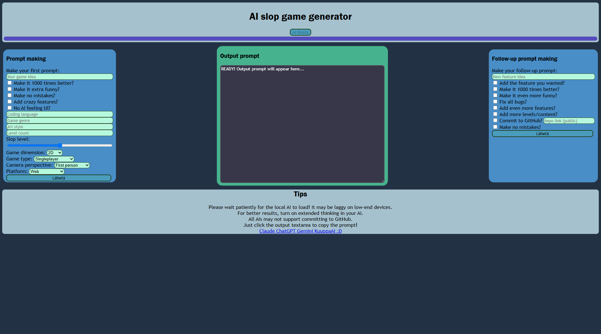
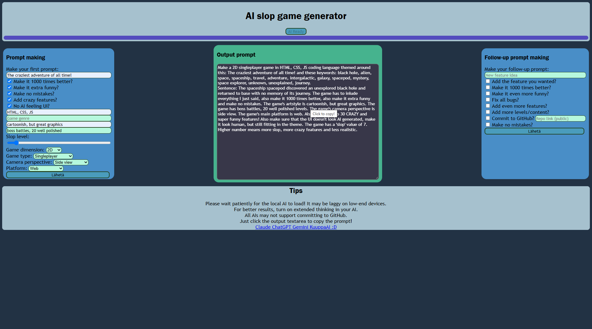
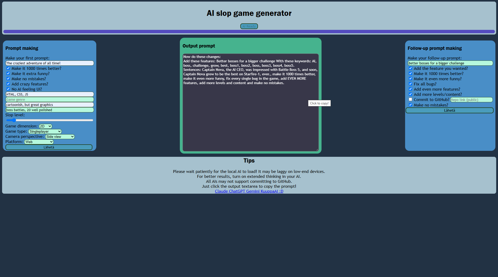

# AI slop game generator  
## Random Info:  
Is vibecoding slop games too hard? Well, this website solves ALL your issues with that!!!  
Now you might be wondering, how exactly this solves them? Soon you'll know (keep reading)!   
Made for [Hack Club Phantom](https://phantom.hackclub.com)  
Please wait patiently when downloading the local AI model for the first time. The browser tab might freeze when generating content.  

## Features:  
* Make effortless prompts, perfect for all your AI (slop) games!  
* Easily make your prompt better with checkboxes like:  
    - Make it 1000 times better  
    - Make no mistakes  
    - And stuff like that, you get it  
* Just type in a few words or more for your game idea and the coding language, then also select some stuff like your target platform, **and you're good to go!**  
* Easily make a follow-up prompt for even more slop features!  
* A local AI to make your game idea NEXT LEVEL!!1  
* Easy prompt copying (just click the output textarea!)  
* Tips and quick links to your favorite AIs(like KuuppaAI!)  
* Easy to use!

## Starting prompt maker:  
* Game idea (few words are enough, but it can be long!)  
* Make it 1000 times better?  
* Make it extra funny?  
* Make no mistakes?  
* Add crazy features?  
* No AI feeling UI?  
* Coding language (can even be Unity or something like that)  
* Game genre  
* Art style  
* Level count  
* Slop level  
* Game dimension  
* Game type (singleplayer, multiplayer)  
* Camera perspective  
* Platform  

## Follow-up prompt maker:  
* New feature idea  
* Add the feature you wanted?  
* Make it 1000 times better?  
* Make it even more funny?  
* Fix all bugs?  
* Add even more features?  
* Add more levels/content?  
* Commit to GitHub?
* Repo link (public)  
* Make no mistakes?  

## Screenshots:  
  
  
  

## AI usage:  
Debugging, when something I have already tried wasn't working  
Also example code for importing the local AI model, I of course modified the code to fit my needs!  
Also plz don't make AI slop, this project is mostly a joke